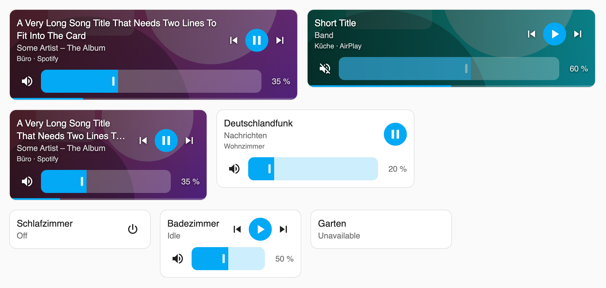
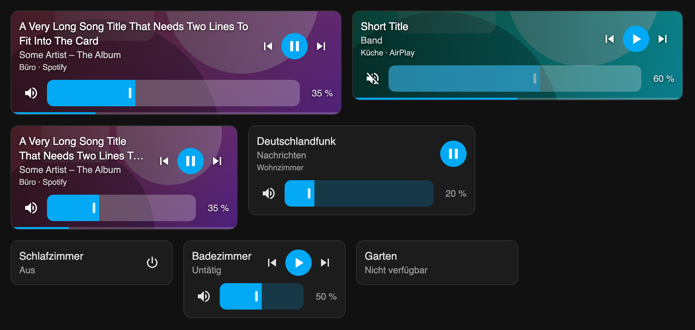

<p align="center">
  <a href="https://my.home-assistant.io/redirect/marketplace_repository/?owner=yannick80&repository=ha-now-playing-card&category=plugin">
    
  </a>
</p>
<p align="center">
  <a href="https://github.com/yannick80/ha-now-playing-card/releases/latest">
    
  </a>
  <a href="https://www.home-assistant.io">
    
  </a>
  <a href="https://github.com/yannick80/ha-now-playing-card/actions/workflows/validate.yml">
    
  </a>
  <a href="https://github.com/yannick80/ha-now-playing-card/releases">
    
  </a>
  <a href="LICENSE">
    
  </a>
</p>

# Now Playing Card

A compact Home Assistant dashboard card for a media player.
It shows what is playing, with the cover as the card's background, and has a **large volume slider** that is easy to hit on small displays.



<!-- ha-marketplace:exclude-start -->
**Contents:**
[What you get](#what-you-get) ·
[What the card shows](#what-the-card-shows) ·
[Before you start](#before-you-start) ·
[Installation](#installation) ·
[Add the card](#add-the-card) ·
[Options](#options) ·
[Tips](#tips) ·
[Troubleshooting & FAQ](#troubleshooting--faq) ·
[Getting help](#getting-help) ·
[For developers](#for-developers) ·
[Credits](#credits)
<!-- ha-marketplace:exclude-end -->

## What you get

- **One card instead of two.** Replaces the built-in `media-control` card plus a `tile` card with the `media-player-volume-slider` feature.
- **Cover as background.** It fills the whole card, darkened so the text stays readable. Without a cover the card uses your theme's colours.
- **Large volume slider.** Tap anywhere to jump to that volume, or drag. Vertical swipes still scroll the page. The slider keeps your value until Home Assistant confirms it, so it does not jump back.
- **Only what your player can do.** Buttons the player does not support are left out.
- **Visual editor.** Search for "Now Playing" in the card picker.
- **Fits the sections dashboard.** Full width by default, height follows the content; works in the masonry view too.
- **No other custom cards needed.** One JavaScript file, no dependencies.
- **Written for old wall tablets too:** no JavaScript or CSS newer than their WebViews understand.

## What the card shows

| State | First line | Second line | Third line | Controls |
|---|---|---|---|---|
| Playing / paused | Title (up to two lines) | Artist – Album | Player · Source, e.g. *Office · Spotify* | previous, play/pause, next, mute, volume |
| On, nothing playing | Player name | State, e.g. *Idle* | Source, if any | play, mute, volume |
| Off | Player name | *Off* | – | power |
| Unavailable | Player name | *Unavailable* | – | – |

While playing, a thin line along the bottom edge shows the progress. The current volume is shown in percent next to the slider; a muted player shows a crossed-out speaker and a faded slider.

<details>
<summary>German interface and dark theme (Deutsch)</summary>



</details>

## Before you start

- [ ] **Home Assistant 2024.12 or newer.**
- [ ] **A `media_player` entity**, from any integration (Sonos, Spotify, Music Assistant, Cast, AirPlay, …).
  The card shows what the entity reports. If a cover or the volume is missing on the entity itself, the card cannot show it either.

<!-- ha-marketplace:exclude-start -->
## Installation

### Home Assistant 2026.11 and newer (Marketplace)

**One click:** select this button, then confirm in your Home Assistant.

[](https://my.home-assistant.io/redirect/marketplace_repository/?owner=yannick80&repository=ha-now-playing-card&category=plugin)

**Or by hand:**

1. In Home Assistant, go to **Settings** > **Marketplace**.
2. In the upper-right corner, select **Add from link**.
3. Under **GitHub link**, enter `https://github.com/yannick80/ha-now-playing-card`. If Home Assistant asks for the type, choose **Dashboard**.
4. Open Now Playing Card and select **Install**.
5. Reload the browser (on phones and tablets: close and reopen the app).

### Home Assistant 2026.10 and older (HACS)

[](https://my.home-assistant.io/redirect/hacs_repository/?owner=yannick80&repository=ha-now-playing-card&category=plugin)

1. Open **HACS** in the sidebar.
2. Select the three dots in the upper-right corner, then **Custom repositories**.
3. Enter `https://github.com/yannick80/ha-now-playing-card`, choose the type **Dashboard**, and select **Add**.
4. Open Now Playing Card and select **Download**.
5. Reload the browser.

### Manual installation

1. Download `now-playing-card.js` from the [latest release](https://github.com/yannick80/ha-now-playing-card/releases/latest) (or `dist/now-playing-card.js` from this repository).
2. Copy it to `config/www/now-playing-card.js` (the `www` folder next to `configuration.yaml`; create it if it does not exist).
3. Go to **Settings** > **Dashboards**, select the three dots, then **Resources**.
   (No **Resources** entry? Turn on **Advanced mode** in your user profile first.)
4. Select **Add resource**, enter `/local/now-playing-card.js?v=1.0.0`, choose **JavaScript module** and select **Create**.
   Raise the `?v=` number after each update so browsers load the new file.
5. Reload the browser.
<!-- ha-marketplace:exclude-end -->

## Add the card

1. Open a dashboard, select the pencil, then **Add card**.
2. Search for **Now Playing** and pick **Now Playing Card**.
3. Pick your player under **Media player**. That's it; everything else is optional.

In YAML:

```yaml
type: custom:now-playing-card
entity: media_player.office
```

## Options

| Option | Default | Description |
|---|---|---|
| `entity` | – | The `media_player` entity (required) |
| `name` | the entity's friendly name | Player name in the third line |
| `show_artwork` | `true` | Cover as card background |
| `show_progress` | `true` | Progress line along the bottom edge |

### Full example

```yaml
type: custom:now-playing-card
entity: media_player.office
name: Office
show_artwork: true
show_progress: false
```

## Tips

- **Tap the title or artist** to open the player's more-info dialog, with source selection, grouping and everything else the card leaves out.
- **Hide the card while the player is off.** In a sections dashboard, open the card's **Visibility** tab and add a condition on the player's state. In other dashboards, wrap the card in a `conditional` card.
- **Keyboard:** the slider takes the arrow keys (5 % steps), Home and End.
- **Volume jumps around while dragging?** Some players need a moment to apply a new volume. The card sends at most about three updates per second while you drag and the final value when you let go.

## Troubleshooting & FAQ

### "Custom element doesn't exist: now-playing-card"

The browser has not loaded the card. Reload the page, and on phones and tablets close and reopen the Home Assistant app.
After a manual install, check the resource under **Settings** > **Dashboards** > **Resources**: `/local/now-playing-card.js` as **JavaScript module**.

### "No media player selected" / "Media player not found"

Pick the player in the card editor. "Media player not found" means the entity ID in the YAML does not exist (any more), for example after the integration was set up again. Pick the player again.

### No cover is shown

The card uses the entity's `entity_picture`. Check the player under **Developer tools** > **States**: if there is no `entity_picture`, the integration does not provide a cover for what is playing. Radio streams often have none.

### No volume slider, or buttons are missing

The card only shows controls the player reports in its `supported_features`. The slider is also hidden while the player is off or does not report a `volume_level`.

### The card still shows the old version after an update

Reload the browser with the cache cleared. The browser console (F12) shows the loaded version as `now-playing-card 1.0.0`.

## Getting help

Open an [issue](https://github.com/yannick80/ha-now-playing-card/issues/new/choose). Please include:

- the card version (shown in the browser console as `now-playing-card x.y.z`),
- your Home Assistant version,
- the media player and its integration,
- your card YAML and, for display problems, a screenshot and the player's attributes from **Developer tools** > **States**.

## For developers

The card is a single plain JavaScript file, `dist/now-playing-card.js`, without build step or dependencies. Edit it, copy it to `config/www/` and reload the browser with the cache disabled.

Tests need only Node.js 22:

```sh
node --test tests/*.mjs
```

`docs/preview.html` shows the real card with a mocked Home Assistant in every state and logs every service call; serve the repository root (`python3 -m http.server`) and open it. The README images are rendered from it: `sh docs/render-previews.sh` (needs Google Chrome).

See [AGENTS.md](AGENTS.md) for the rules the card follows (old WebViews, error handling, slider behaviour) and [CHANGELOG.md](CHANGELOG.md) for what changed.

**Translations** are welcome: add a language to `STRINGS` in `dist/now-playing-card.js` and open a pull request.

**Releasing:** bump `VERSION` in `dist/now-playing-card.js`, move the CHANGELOG entry to the new version, then publish a GitHub release with the tag `vX.Y.Z`. The release workflow checks the version and attaches the file.

## Credits

Inspired by **[mini-media-player](https://github.com/kalkih/mini-media-player)** by [kalkih](https://github.com/kalkih), whose full-cover artwork style this card borrows. If you need more options (grouping, source and sound mode selection, TTS, shortcuts), mini-media-player is the card to use.

The icons are from [Material Design Icons](https://pictogrammers.com/library/mdi/), which ship with Home Assistant.

## License

[MIT](LICENSE)
